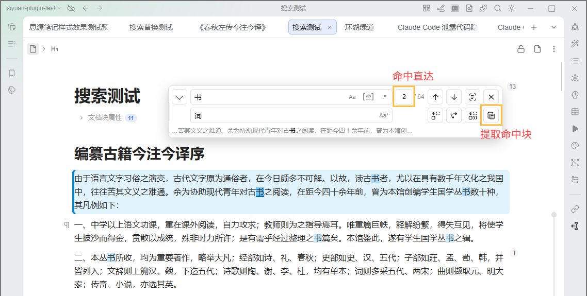
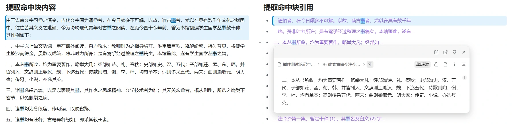
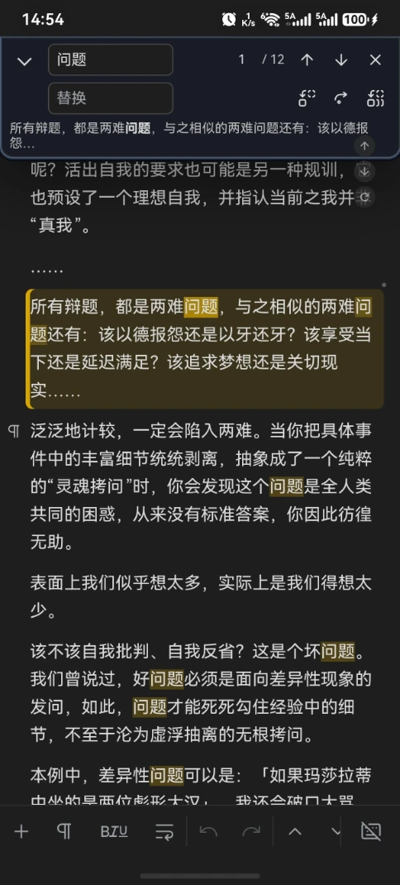
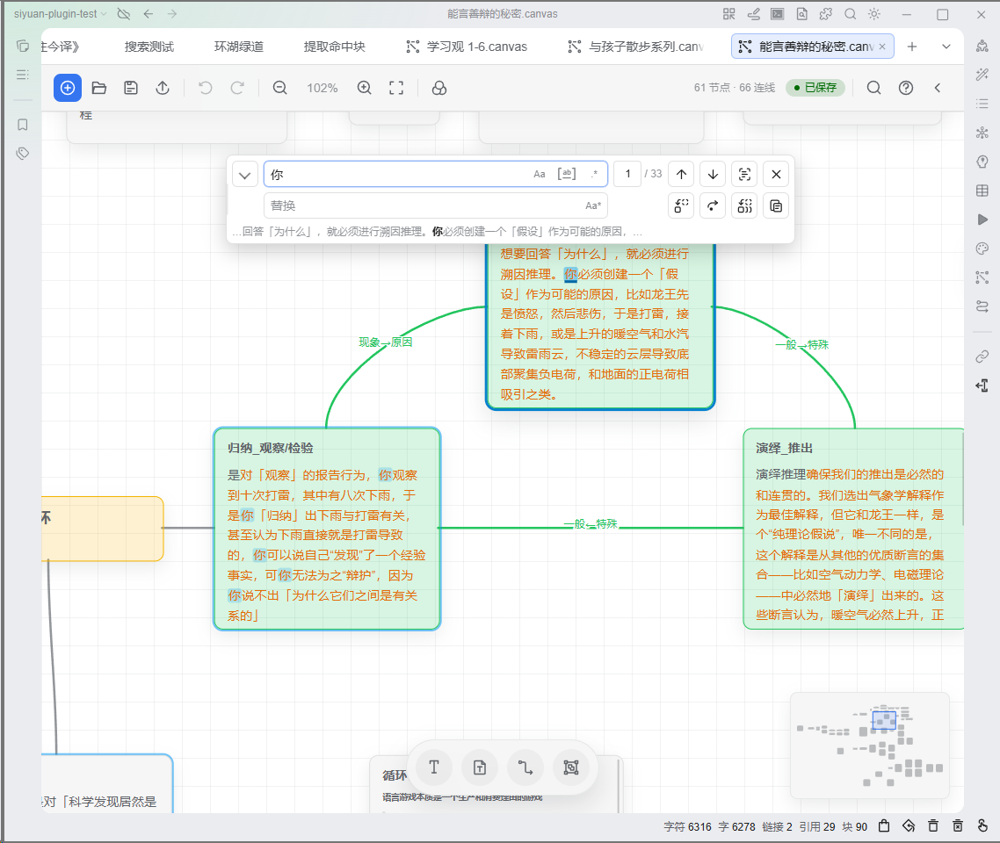
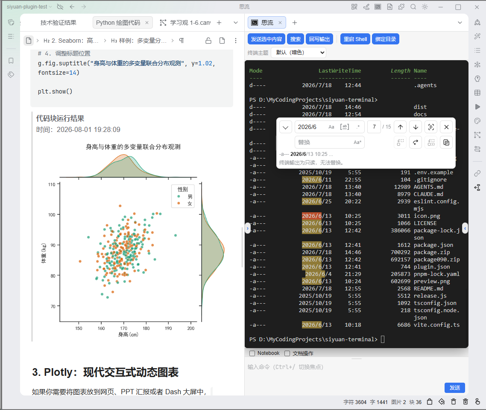

# 命中提取、移动端、插件联动——搜easy v1.3.0 新功能预览

思源笔记插件开发实践 [*](https://ld246.com/article/1785584107282)

## 搜easy v1.3.0

### 新增

- **命中直达**：支持编辑搜索结果序号，直接跳转到对应命中结果位置；
- **提取命中块**：提取包含搜索关键词的块内容/块引用（默认为块内容，支持设置为块引用）批量复制到剪贴板，可以粘贴到任意文档，供后续处理；

  
- **支持移动端**：支持在手机等移动设备上使用搜索/替换基础功能；

  

  ---
- **插件联动**：支持 无界（siyuan-canvas）的画布文本搜索与替换；

  
- **插件联动**：支持 思流 (siyuan-terminal，暂未上架) 终端文本的搜索；

  

### 优化

- 搜索性能优化；
- UI、图标、预览效果等细节优化，提升用户体验；

‍

## 附录

[思源“搜 easy”插件——解决日常难题，逐个搜索，逐个替换，so easy！ - 链滴](https://ld246.com/article/1773545098779) *

[为了让思源笔记用起来更顺手，我打算开发 10 个插件，目前进度…… - 链滴](https://ld246.com/article/1775894033664) *
