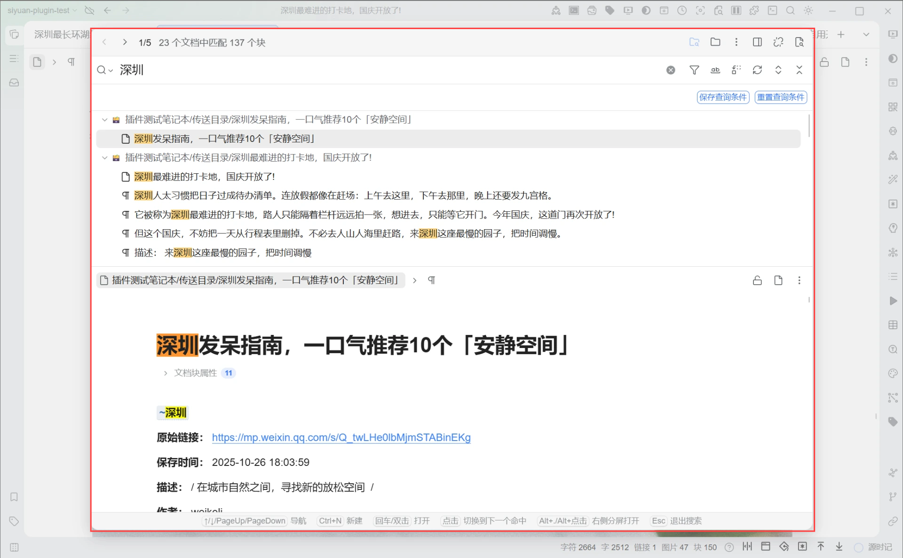
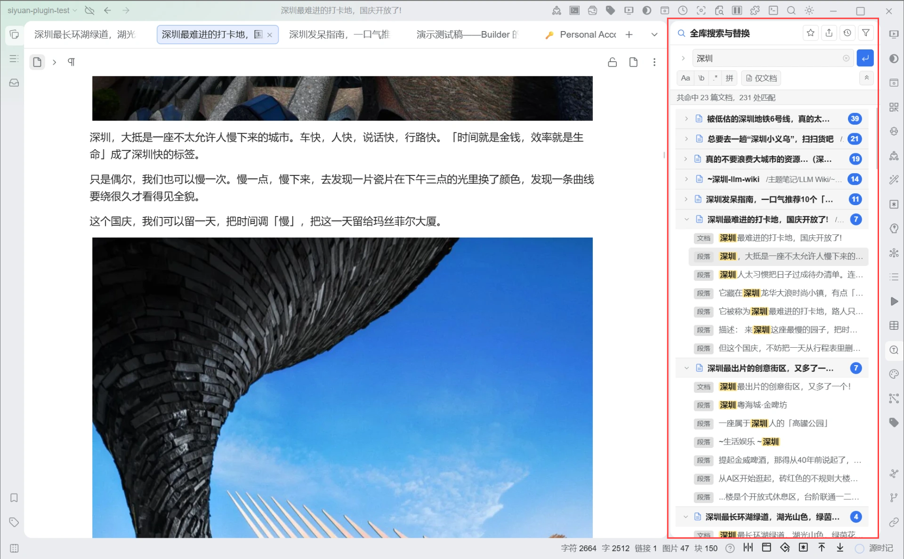
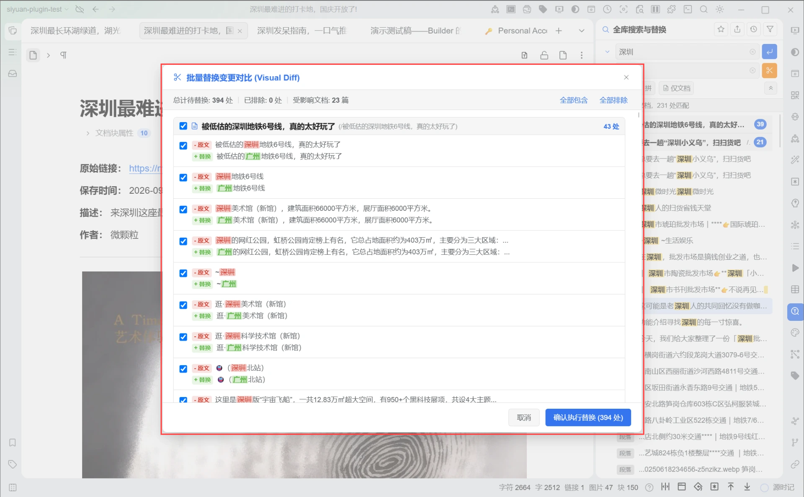
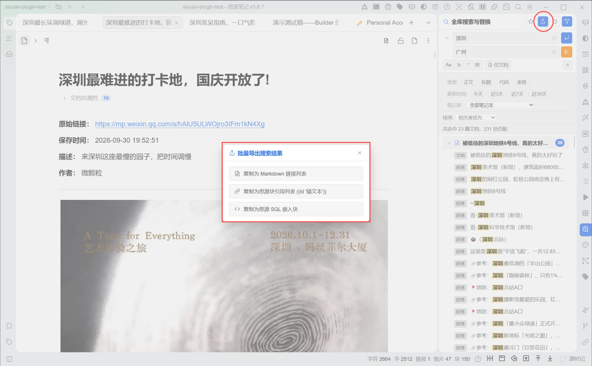

# 更大的疆域，更快的搜索——搜easy v2.0.0 新功能预览

思源笔记插件开发实践 [*](https://ld246.com/article/1792329430670)

## 楔子

几个月前，我开发“搜 easy”插件，是为了改掉思源笔记在文档内搜索关键词时那套反直觉的交互——在文档里查找、替换文字，居然要弹出一个独立窗口，再在这个并不直观的窗口里操作，而不是在原文档中边看边改、所见即所得。更别扭的是，搜到的结果不按原文顺序排列；替换时又只能整段替换，没法逐个关键词处理（参见：[思源“搜 easy”插件——解决日常难题，逐个搜索，逐个替换，so easy！ - 链滴](https://ld246.com/article/1773545098779)）。后来，“搜 easy”经过大大小小十余次迭代打磨，官方集市也陆续出现了一批优秀的搜索增强插件，思源笔记在单篇文档内搜索关键词的体验短板基本被补齐了。

我起初觉得跨文档搜索还算能用，所以“搜 easy”只覆盖单文档场景。可实际用久了，那种割裂感又回来了：每次搜索都要跳转到独立弹窗；而跨文档搜索最常见的场景，是给当前创作主题找参考资料，常常不能一次命中目标文档，或者要反复更换搜索词——于是，弹窗开了关、关了开，来回切换，十分不便。

多次遇到这种情况后，我迭代了“搜 easy”v2.0（Beta），希望进一步改善思源笔记的搜索体验。近期上架之后，欢迎大家试用反馈。

‍

## 搜easy v2.0.0 (Beta)

‍

### 新增

- **全库跨文档搜索与替换（搜索侧栏）**      ：全新支持在思源右侧栏进行全库范围的跨文档检索与批量替换，检索时不遮挡主编辑区当前文档，支持边查边读，随时切换搜索命中文档；

  - **文档树状聚合与一键展开**：检索结果按“笔记本 / 文档”层级树状归类展示，条理清晰；支持一键展开或折叠全部文档，海量命中结果也能轻松浏览；

    
  - **仅搜索文档标题**：搜索栏支持“仅搜索文档”快捷过滤开关（默认开启），开启后仅在文档标题中精准匹配，秒级快速定位目标文档；

    
  - **中文拼音与首字母搜索**：支持中文汉字拼音首字母缩写（如输入 ​`sz` 匹配“深圳”）及全拼模糊检索，内置数千常用汉字拼音词库，找中文资料更加快捷自如；

    
- **批量替换**：支持跨文档批量替换关键词，采用分批异步调度机制，处理大批量文档时避免思源笔记界面长时间无响应或卡死；

  - **批量替换 Visual Diff 差异预览**：执行跨文档批量替换前，可调出可视化差异对比视窗，直观查看替换前后的文字变动细节；支持逐项或按整篇文档单独勾选/排除，杜绝误替换；
  - **替换事务历史与一键撤销回退**：批量替换自动记录操作历史，支持一键安全撤销回滚，误替换也可随时安全还原；
  - **正则高级捕获组替换**：正则表达式替换模式支持反向引用捕获组（如 ​`$1`​、​`$2`），轻松应对复杂的批量排版与文本结构重组；

  
- **结果批量导出与搜索预设**：

  - **结果导出**：支持将搜索结果一键批量导出为 Markdown 双链列表、思源块引用或 SQL 嵌入块，便于知识整理与二次归纳；

    
  - **搜索预设**：支持将高频使用的搜索条件、过滤选项保存为预设，方便日后一键调用；
- **回车后启动搜索（防卡顿）** ：设置页新增“回车后启动搜索”选项（默认关闭）。开启后输入关键词不触发实时扫描，按下 Enter 键后才执行检索，大幅提升超大长文档输入时的流畅度；

‍

### 改进

- **长文档选区性能优化（消除打字与拖选卡顿）** ：重构选区搜索范围统计逻辑，仅在实际选中区域内快速扫描，彻底解决数千块大型文档在日常频繁打字、删除内容或鼠标拖选时的输入卡顿与掉帧现象；
- **平滑分批异步替换**：跨文档批量替换执行引擎采用分批异步调度机制，处理海量文档替换时平滑稳定，避免思源笔记界面长时间无响应或卡死；
- **表格搜索定位优化**：优化全库搜索对复杂表格内容的跳转定位，点击命中项可直接滚动居中定位到表格的具体行与单元格，并附带动态高亮闪烁提醒；
- **即时输入响应与防误触**：搜索框输入修改时即时清空旧结果并提示按回车检索，按下 Enter 键或点击搜索按钮正式执行；全面适配中文输入法，拼音选词敲击回车时不再误触发全局检索；
- **明暗双主题与高对比度适配**：深度优化白天与暗黑模式下的色彩对比度，重构结果数量徽标、高亮激活态与路径文本展示，在各种思源主题下均清晰醒目；
- **面板宽度记忆**：拖拽调整搜索与替换面板的宽度后自动记忆，重新打开面板或切换文档时自动保持上一次调整的宽度，无需每次重复拉伸；

‍

## 附录

- [思源“搜 easy”插件——解决日常难题，逐个搜索，逐个替换，so easy！ - 链滴](https://ld246.com/article/1773545098779) *
- [命中提取、移动端、插件联动——搜 easy v1.3.0 新功能预览 - 链滴](https://ld246.com/article/1785584107282) *
- [为了让思源笔记用起来更顺手，我打算开发 10 个插件，目前进度…… - 链滴](https://ld246.com/article/1775894033664) *
